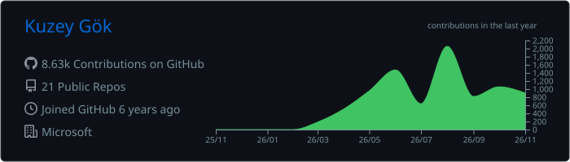
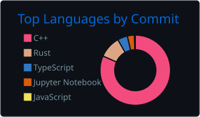
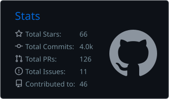

  

  SDE at Microsoft · Fallout 4 rendering, modding tools, ML from scratch 
  <a href="https://northaxosky.github.io">Portfolio</a> ·
  <a href="https://www.linkedin.com/in/kuzeygok/">LinkedIn</a> ·
  <a href="https://www.nexusmods.com/profile/MuteBustNut">Nexus</a> ·
  <a href="https://x.com/MuteBusterr">X</a>

## Projects

<table>
  <tr>
    <td width="50%" valign="top">
      <h3><a href="https://github.com/northaxosky/fallout4-community-shaders">Community Shaders · FO4</a></h3>
      Porting Skyrim's Community Shaders to Fallout 4's renderer.  
      
      
    </td>
    <td width="50%" valign="top">
      <h3><a href="https://github.com/community-shaders/skyrim-community-shaders">Community Shaders · Skyrim</a></h3>
      Contributor to the Skyrim renderer overhaul it's ported from.  
      
      
    </td>
  </tr>
  <tr>
    <td width="50%" valign="top">
      <h3><a href="https://github.com/Dear-Modding-FO4/Addictol">Addictol</a></h3>
      Engine fixes and crash patches, with Dear Modding FO4.  
      
      
    </td>
    <td width="50%" valign="top">
      <h3><a href="https://github.com/Dear-Modding-FO4/DearModdingUI">Dear Modding UI</a></h3>
      A shared in-game mod menu for F4SE plugins.  
      
      
    </td>
  </tr>
  <tr>
    <td width="50%" valign="top">
      <h3><a href="https://github.com/northaxosky/overseer">overseer</a></h3>
      A terminal mod manager for Fallout 4.  
      
      
    </td>
    <td width="50%" valign="top">
      <h3><a href="https://github.com/northaxosky/sky-ai">sky-ai</a></h3>
      GPT-2 124M from scratch, plus the training stack.  
      
      
    </td>
  </tr>
</table>

## Stats

  
  

